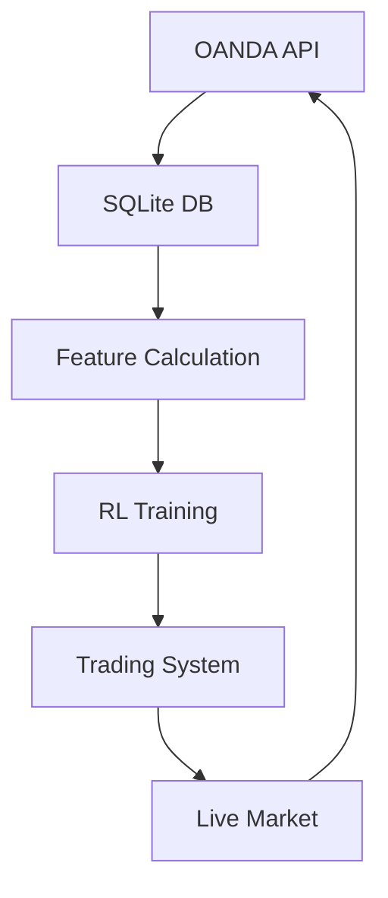

# Forex RL Trading System Progress Summary

## Current Status
- **Data Pipeline**: Complete
- **Feature Engineering**: Fibonacci features implemented
- **Database**: Populated with 20 forex pairs (2007-2025)
- **RL Model**: PPO implementation with custom reward function
- **Training**: Successful initial run (10,000 timesteps)

## Key Achievements
1. **Data Pipeline**:
   - Automated OANDA data download
   - SQLite storage with efficient schema
   - Feature calculation script

2. **Feature Engineering**:
   - 15 Fibonacci-based features per instrument
   - 300 total input features (20 instruments × 15 features)
   - Robust handling of missing data

3. **Reinforcement Learning**:
   - Custom neural network architecture (300 → 500 → 240 → 120 → 20)
   - Differential Sharpe Ratio reward function
   - Dirichlet-inspired position sizing
   - Entropy-based diversification penalty

4. **Training Success**:
   - Stable learning curve
   - Decreasing loss (36.4 → 23.8)
   - Validated reward calculation

## Tool Usage Tips
### Essential Tools:
1. **SQLite Browser**: Inspect database tables
   - Recommended: [DB Browser for SQLite](https://sqlitebrowser.org/)

2. **TensorBoard**: Monitor training progress
   ```shell
   tensorboard --logdir tensorboard/
   ```

3. **Data Validation Script**:
   ```python
   # Sample validation
   import sqlite3
   import pandas as pd
   
   conn = sqlite3.connect('data/forex_candles.sqlite3')
   features = pd.read_sql_query("SELECT * FROM features LIMIT 10", conn)
   print(features.head())
   ```

### Codebase Navigation:
```markdown
Key Files:
- `training/trainer.py`: Main RL training script
- `scripts/data_download.py`: OANDA data fetcher
- `scripts/calculate_features.py`: Fibonacci feature calculator
- `config/forex_pairs.py`: Instrument configuration
```

## Performance Optimization
1. **Initial Validation**:
   - Start with 5 instruments
   - Limit to 5,000 timesteps
   - Verify reward calculation

2. **Gradual Scaling**:
   - Increase instruments incrementally
   - Monitor memory usage
   - Validate after each scaling step

3. **Monitoring**:
   - Use TensorBoard for real-time metrics
   - Check checkpoint files regularly

## Next Steps
1. **Extended Training**:
   - Run for 1,000,000 timesteps
   - Implement early stopping

2. **Feature Enhancement**:
   - Add technical indicators (RSI, MACD)
   - Incorporate market sentiment data

3. **Backtesting Framework**:
   - Walk-forward validation
   - Realistic transaction cost modeling

4. **Deployment**:
   - Connect to live market data
   - Implement risk management controls
   - Automated trading execution

## Troubleshooting Guide
| Issue | Solution |
|-------|----------|
| NaN values | Normalize features, add epsilon to divisions |
| SQL errors | Use CTEs for complex queries, handle NULLs |
| Dependency conflicts | Use virtual environments, pin versions |
| Training instability | Gradient clipping, reward clipping |

## Architecture Diagram


**Date**: Thu May 29 2025  
**Project Lead**: King James  
**Status**: Training completed successfully - ready for scaling