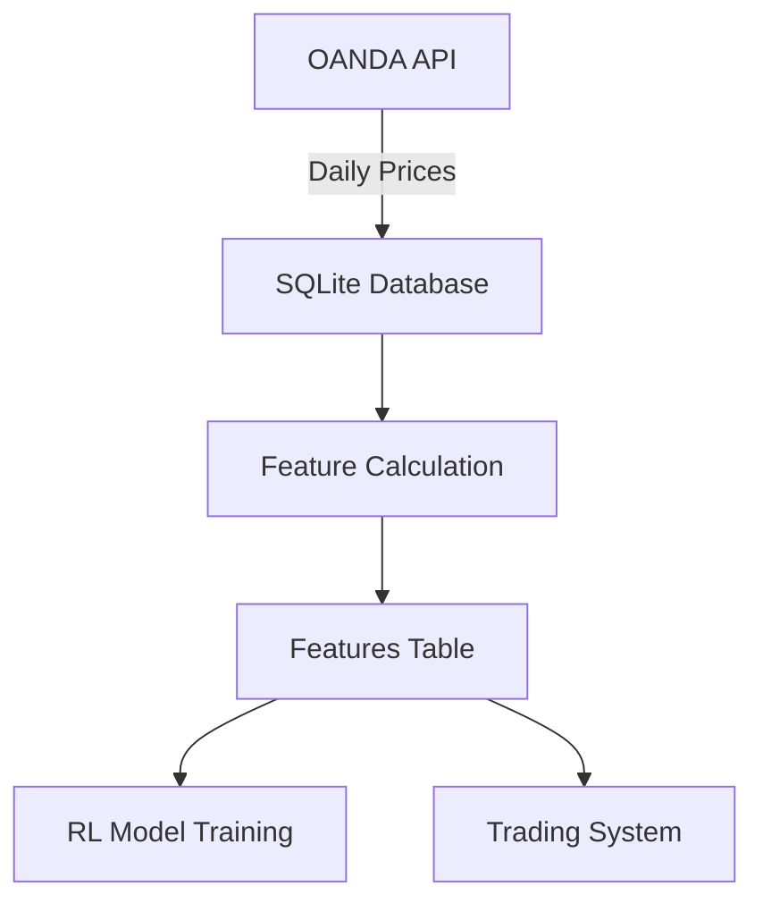

# Forex RL Trading System - Data Pipeline Documentation

## Overview
We've implemented a complete data pipeline for the Forex RL Trading System that:
1. Fetches historical daily forex data from OANDA
2. Stores raw candle data in SQLite database
3. Calculates Fibonacci-based features
4. Stores features for RL model training

## Database Location
`/forex-rl/data/forex_candles.sqlite3`

## Database Schema
```sql
-- Candles table (raw price data)
CREATE TABLE candles (
    instrument TEXT NOT NULL,
    time TEXT NOT NULL,
    open REAL NOT NULL,
    high REAL NOT NULL,
    low REAL NOT NULL,
    close REAL NOT NULL,
    volume INTEGER NOT NULL,
    PRIMARY KEY (instrument, time)
);

-- Features table (calculated features)
CREATE TABLE features (
    instrument TEXT NOT NULL,
    time TEXT NOT NULL,
    feat_1 REAL,
    feat_2 REAL,
    feat_3 REAL,
    feat_5 REAL,
    feat_8 REAL,
    feat_13 REAL,
    feat_21 REAL,
    feat_34 REAL,
    feat_55 REAL,
    feat_89 REAL,
    feat_144 REAL,
    feat_233 REAL,
    feat_377 REAL,
    feat_610 REAL,
    feat_987 REAL,
    PRIMARY KEY (instrument, time)
);
```

## Data Specifications
| Aspect                  | Specification                                   |
|-------------------------|------------------------------------------------|
| **Time Range**          | 2007-10-14 to 2025-05-27 (4999 days per pair)  |
| **Forex Pairs**         | 20 major pairs (EUR_USD, USD_JPY, etc.)        |
| **Fibonacci Periods**   | [1, 2, 3, 5, 8, 13, 21, 34, 55, 89, 144, 233, 377, 610, 987] |
| **Total Candles**       | 20 pairs × 4999 days = 99,980 candles          |
| **Total Features**      | 20 pairs × 4999 days × 15 features = 1,499,700 data points |

## Feature Calculation
For each instrument and time point, we calculate:
```python
feat_i = (close_t / close_{t-i}) - 1
```
Where:
- `i` is a Fibonacci period
- For periods before available data, we use the first available close price (forward-fill technique)

## Key Scripts
### 1. Data Download Script
`/forex-rl/scripts/data_download.py`
```bash
# Download full dataset (5000 candles per instrument)
python3 scripts/data_download.py --full

# Quick test (100 candles for 3 instruments)
python3 scripts/data_download.py --quick
```

### 2. Feature Calculation Script
`/forex-rl/scripts/calculate_features.py`
```bash
# Calculate features for all instruments
python3 scripts/calculate_features.py --all

# Calculate features for single instrument
python3 scripts/calculate_features.py --instrument EUR_USD
```

### 3. One-Command Pipeline
`/forex-rl/run_data_download.sh`
```bash
#!/bin/bash
# Run complete data pipeline
python3 scripts/data_download.py --full
python3 scripts/calculate_features.py --all
```

## Accessing Data
### Python Example
```python
import sqlite3
import pandas as pd

# Connect to database
conn = sqlite3.connect('data/forex_candles.sqlite3')

# Get features for EUR_USD
features = pd.read_sql_query(
    "SELECT * FROM features WHERE instrument='EUR_USD'", 
    conn
)

# Get raw candles for GBP_USD
candles = pd.read_sql_query(
    "SELECT * FROM candles WHERE instrument='GBP_USD'", 
    conn
)
```

### SQL Queries
```sql
-- Get latest features for all instruments
SELECT * FROM features 
WHERE time = (SELECT MAX(time) FROM features);

-- Get feature statistics for AUD_USD
SELECT 
    AVG(feat_1) AS avg_feat1,
    AVG(feat_5) AS avg_feat5,
    AVG(feat_21) AS avg_feat21
FROM features 
WHERE instrument='AUD_USD';
```

## Next Steps
1. **Model Training**: Use features table to train RL models
2. **Real-time Updates**: Implement daily data refresh
3. **Feature Enhancement**: Add technical indicators (RSI, MACD)
4. **Backtesting**: Implement backtesting framework using historical data

## Architecture Diagram


## Troubleshooting
1. **Database Locked**: Ensure no processes are accessing the DB
2. **Missing Data**: Re-run `data_download.py --full`
3. **Feature Errors**: Re-run `calculate_features.py --all`
